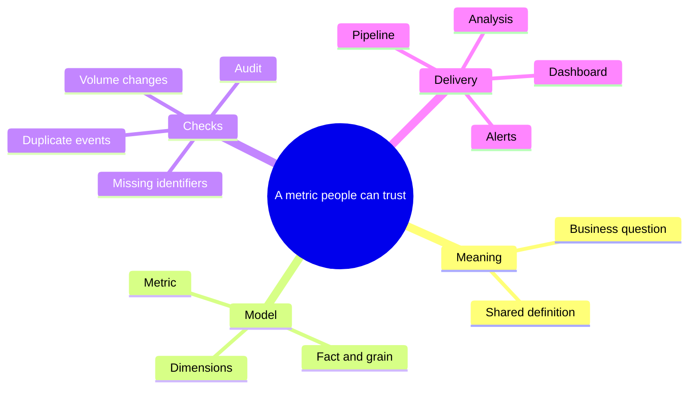

<header class="article-header">
    <div class="article-header__inner">
        <p class="article-kicker">Issue 03 · AI visual design</p>
        <h1>Using AI for visuals: design and explanation</h1>
        <p class="article-deck">How Mermaid gives AI an editable language for turning rough explanations into useful technical diagrams.</p>
        <p class="article-date">
          <svg viewBox="0 0 24 24" aria-hidden="true"><path d="M7 2v4M17 2v4M3.5 9.5h17M5.5 4h13a2 2 0 0 1 2 2v13a2 2 0 0 1-2 2h-13a2 2 0 0 1-2-2V6a2 2 0 0 1 2-2Z"/></svg>
          <span><span class="visually-hidden">Published </span>9 October 2026</span>
        </p>
    </div>
</header>

<p class="article-summary">
  <svg viewBox="0 0 24 24" aria-hidden="true"><path d="M4 4h16v13H8l-4 4V4Z"/><path d="M8 8h8M8 12h6"/></svg>
  <span><strong class="visually-hidden">In short: </strong>Mermaid gives AI a text language for diagrams. It does not make AI a mind reader, but it makes a rough idea much easier to draw, challenge, and change.</span>
</p>

## I draw while I think

As a technical trainer, I was constantly drawing mind maps.

At one point, I explained the Azure world through Harry Potter. Databricks was Hagrid. The boats taking first-year students to Hogwarts became identity onboarding. ADF was the Great Hall, and the houses were ADLS storage containers.


The drawings began in PowerPoint, then escaped into Inkodo and onto whiteboards like Klaxoon. The problem was repetition: I drew the same thing for the next class and then again the following week.

Copilot at the time could barely generate a reliable sentence in a drawing. It also could not decide how many fingers a human should have, never mind recreate one of my beautiful stickmen.

I am a visual thinker. A drawing is rarely decoration for me. It is often the moment when a list of services, steps, or concepts finally makes sense. Doodles, on the other hand, are clearly works of art and should always be available to entertain me in less-than-interesting meetings.

When my team started sharing diagrams in our knowledge and design documents, I assumed they were making them in draw.io and pasting in an image. It turned out they were describing them in code and generating them through VS Code extensions.

We mainly use:

- **Mermaid** for flowcharts, mind maps, and other structured diagrams
- **Excalidraw** when an idea needs a freer, hand-drawn shape

There are plenty of other tools, but these give us a useful starting point. I use Mermaid whenever I can because the source is text. It can:

- live beside the document;
- survive a wording change; and
- give AI something precise to edit.

It is simple. I like simple.

## Give the diagram one job

Here is a deliberately simple example:

> What has to be true before somebody can trust a metric?



<a href="{{ '/examples/ai-visuals-design-explanation/example-1-trustworthy-metric.mmd' | relative_url }}">View the Mermaid source for Example 1.</a>

For a learner, this is a map of the lesson before we disappear into syntax. I can point to where SQL, semantic modelling, and data quality fit without pretending that one tool is the whole answer.

For a project team, the same diagram is a design conversation. Somebody can challenge the grain, add a missing check, or ask who owns the definition. Because the diagram is in text, that correction takes seconds rather than a new drawing session.

Technical diagrams should all be designed to be a little bit stupid. Their job is to make one idea easier to see. If a diagram becomes complicated, that may be useful evidence that the process is complicated too.

My rule now: if I cannot explain the diagram's job in one sentence, I am not ready to argue about colours.

## AI still needs direction

My thoughts can be busy. My explanations can be busy. Unsurprisingly, my documentation and drawings can become busy too. I get told this all the time. Thanks, Seb, my lead, who pointed it out today (2026-10-08).

I saw this while trying to explain a dimension table called `dim_button`. The example here is fictional and scrubbed, but the design problem is real.

My goal was to show four mapped columns and representative values. My first attempt tried to show the table, definitions, categories, examples, rules, and relationships all at once.


<a href="{{ '/examples/ai-visuals-design-explanation/example-2-dim-button-iteration-1.mmd' | relative_url }}">View the Mermaid source for Iteration 1.</a>

It was alphabetti spaghetti. The syntax worked. The visual did not.

### Use AI to simplify a busy idea

In training, I used a prompt coach to improve an instruction before asking AI to do the thing. Mine used GCSE. I adapted that approach into a Mermaid visual agent.

I do not think prompting is disappearing. Even with agentic tools, we are still trying to explain what we want to a machine. GCSE helps me spot what I forgot:

- **Goal:** What should somebody understand from the diagram?
- **Context:** Where will the visual be used, and who is the audience?
- **Sources:** What code, examples, screenshots, or schemas are available?
- **Expectations:** What must the final visual include or deliberately omit?

For a visual, I sneak in one more question:

> **Visual intent:** What should the viewer notice first, second, and third?

I also ask the agent to fix the information architecture before making things pretty, recommend a diagram type, and explain what changed. That turns "draw this" into something closer to a design review.

The first revision separated column definitions from illustrative values:


<a href="{{ '/examples/ai-visuals-design-explanation/example-2-dim-button-iteration-2.mmd' | relative_url }}">View the reconstructed Mermaid source for Iteration 2.</a>

**Better:** the column definitions and values were finally separated.

**Still not what I meant:** the values were governed mappings, not example records. Calling them "illustrative values" changed the meaning.

My next instruction clarified the hierarchy:

```text
dim_button
  -> mapped column
    -> governed value
```

That led back to a mind map, but with the descriptions, placeholder identifiers, and repeated classifications removed:


<a href="{{ '/examples/ai-visuals-design-explanation/example-2-dim-button-iteration-3.mmd' | relative_url }}">View the Mermaid source for Iteration 3.</a>

After all that, the final version returned to a mind map. It answers one question:

> Which governed values belong to each mapped `dim_button` column?

The full sanitised iteration notes show the critique and corrections in more detail: <a href="{{ '/examples/ai-visuals-design-explanation/dim-button-ai-visual-iteration-example.txt' | relative_url }}">Refining the dim_button Mermaid diagram</a>.

## The good

- It speeds up the visual part of a design document.
- The diagram becomes a reusable asset instead of a disposable screenshot.
- It gives me something concrete to disagree with.
- Small changes do not require me to start again.

## The bad

- AI is strangely bad at colour names.
- It does not always understand the layout I have in my head.
- On a good day, the result still takes three or four attempts.
- On a bad day, I sketch it on paper and provide the sketch as a reference.

AI can translate an idea, but first I need to know what the image is trying to say. "Make me a nice architecture diagram" usually produces architecture soup. A question, an audience, and a rough hierarchy produce something more useful.

## What I actually do now

1. Write the question the diagram must answer.
2. List the essential parts in plain text.
3. Use GCSE to ask AI for the simplest Mermaid diagram that connects them.
4. Challenge the hierarchy and meaning before discussing colour.
5. Remove anything that needs a paragraph to explain, then treat the output as a draft.

## In summary

I use Mermaid for structured visuals that need to live beside code or documentation. My team reaches for Excalidraw when an idea needs a freer shape.

The tool matters less than giving the visual one job. I also still believe ASCII is sometimes a better teacher than a polished diagram:

```text
              TABLE
          dim_button
               |
     +---------+-----------+
     |         |           |
   COLUMN    COLUMN      COLUMN ...
     |
  VALUES
```


Next week, I'll extend this into dashboards and complex visualisations by sharing a fictional Streamlit heatmap project.

Note: Most of this text was designed and written by a human, then waffled and edited by AI.

#TodayAILearned #VSCode #ArtificialIntelligence #Mermaid #DataVisualisation
